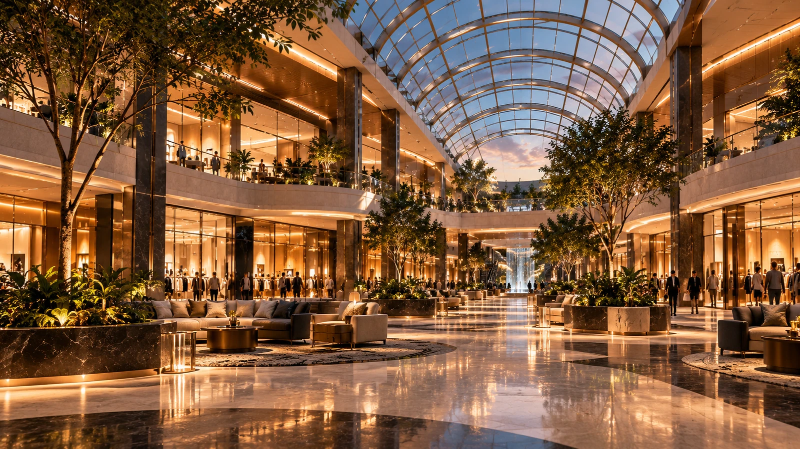

# Real Mall of America — Actual Asset Library

**This repository contains 273 actual media files, not only briefs or mockup screenshots.** File counts include color, responsive-size and format variants. They are not claims of 273 unique photographs.

## Browse

Open `index.html` for the visual asset library or `preview/storefront.html` for the storefront composition. Both use relative local files. Shopping links in the preview lead to the existing Shopify store; no fake checkout is implemented.

## Produced files

| Folder | Files |
| --- | ---: |
| backgrounds | 12 |
| brand | 17 |
| campaigns | 2 |
| email | 1 |
| hero | 14 |
| icons | 216 |
| masters | 1 |
| motion | 7 |
| social | 3 |

Department source coverage: **0 of 9**. Source photography registry: `production/sources.json`. Exact dimensions, bytes and hashes: `production/asset-manifest.json` and `production/SHA256SUMS.txt`.

## What is included

- Raster identity system: transparent wordmarks, monograms, favicon variants and a social avatar.
- 36 original interface symbols, each in three tones and two raster sizes; **216 icon exports, not 216 different symbols**.
- Six atmospheric material backgrounds, supplied as PNG and WebP.
- Separately generated campaign masters and responsive JPEG/WebP crops where generation succeeded.
- Rendered campaign, social and email artwork with editable copy in JSON.
- Actual MP4/WebM silent camera-motion loops with still posters. **These animate still images; they are not live-action or independently generated cinematic footage.**
- Optional Shopify sections, scoped CSS and motion controls, with uniquely named flat media exports under `theme/assets/`.

## Scope and provenance

The native architectural campaign was generated in this conversation and transferred through the merchant's Shopify CDN. Additional independent scenes use the documented free Pollinations Classic generator; original provider-marked masters are preserved, along with prompts and provenance. Responsive crops are derivatives. All imagery is editorial atmosphere, not a representation of a stocked SKU or proof of premises ownership. No relationship with the physical Mall of America is asserted.

No font files are redistributed. Existing supplier product photographs must remain authoritative. No fabricated reviews, discounts, shipping promises, supplier badges or guarantees are included.

**The live Shopify theme has not been changed.** Install the optional sections in an unpublished theme, check actual image crops and commerce behavior, and complete storefront QA before publishing. This asset library is not a full Shopify theme ZIP and is not a compliance certification.

## Unfinished image generations
- autumn: Rejected after visual review: wrong subject. A replacement has not yet been approved.
- bags-travel: Rejected after visual review: wrong subject. A replacement has not yet been approved.
- beauty-self-care: Rejected after visual review: wrong subject. A replacement has not yet been approved.
- digital-downloads: Rejected after visual review: wrong subject. A replacement has not yet been approved.
- fashion-accessories: Rejected after visual review: wrong subject. A replacement has not yet been approved.
- holiday: Rejected after visual review: wrong subject. A replacement has not yet been approved.
- home-kitchen: Rejected after visual review: wrong subject. A replacement has not yet been approved.
- kids-hobbies: Rejected after visual review: wrong subject. A replacement has not yet been approved.
- outdoors-fitness: Rejected after visual review: wrong subject. A replacement has not yet been approved.
- pets: Rejected after visual review: wrong subject. A replacement has not yet been approved.
- spring: Rejected after visual review: wrong subject. A replacement has not yet been approved.
- summer: Rejected after visual review: wrong subject. A replacement has not yet been approved.
- tech-desk: Rejected after visual review: wrong subject. A replacement has not yet been approved.

## Rebuild

`python -m pip install Pillow numpy cairosvg` then `python scripts/import_atrium.py`, `python scripts/produce_photography.py`, `python scripts/build_library.py`, and `python scripts/build_preview.py`. Install FFmpeg for video encoding. Existing scene masters are reused; only missing sources are requested. No API keys are required and no paid generation calls are made.
