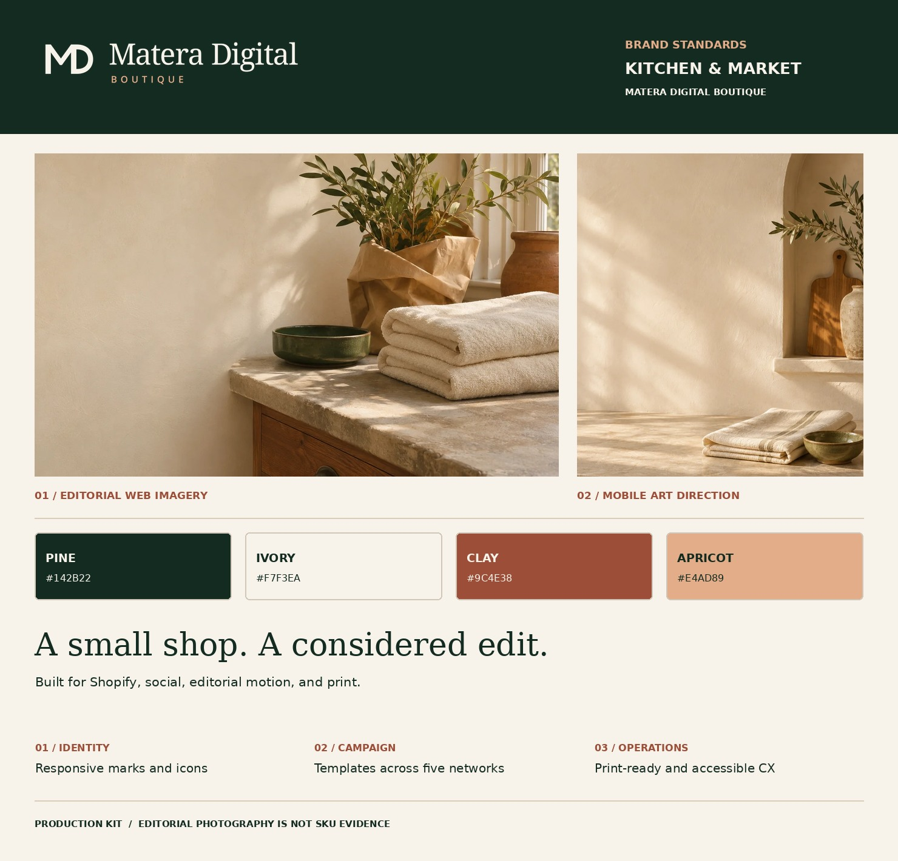

# Matera Digital Boutique
## Production brand kit · Kitchen & Market

A coordinated replacement for customer-facing Real Mall brand assets. Open **[the searchable asset gallery](integration/index.html)** after downloading and extracting the kit. Open **[the storefront design proof](storefront/preview/index.html)** to see the stills and styling together. The previous mall repository and Shopify production remain intact.

| Need | Start here |
| --- | --- |
| Logos, avatar, PNG, SVG, favicon and web clips | [Identity placement guide](identity/README.md) |
| Responsive desktop/mobile Shopify hero, editorial cards, WebP and share JPEG | [Storefront deployment notes](storefront/README.md) |
| Campaign, profile/header, Story, Pin, Reel and YouTube treatments | [Channel templates and sizes](social/README.md) |
| Silent MP4, WebM and GIF proof | [Motion notes](media-motion/README.md) |
| Packing insert, seal, label, email headers and support language | [Print and operations](print/README.md) |
| Retire or replace legacy assets without a broken storefront | [Migration map](integration/docs/MIGRATION.md) and [Release checks](integration/docs/QA.md) |

### Point of view
Useful things for every day. Pine, ivory, clay and warm sunlight. Modern editorial serif for headlines, clear sans for everything customers need to act on. Photograph kitchens and market routines for the atmosphere; use authorized exact-variant photography for any listing or SKU-specific claim.

### Release boundary
This is the brand package, not a global Shopify theme change or an ad launch. Do not deploy product content or discounts before each SKU clears verification and economics. Printed branding is a template for merchant-packed orders; do not promise it for Collective orders. No app, subscription or domain purchase required. Font sources and generated imagery are documented.

### Repository mirror
This branch carries the editable kit, web and campaign exports, print assets and compressed editorial source masters. The standalone owner archive additionally contains uncompressed photo masters and the desktop GIF review loop. The original mall library and default branch are unchanged.
